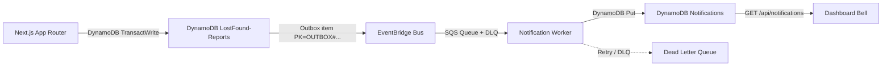

# Lost & Found — Milestone 1: Event-Driven Lifecycle Processing

## Architecture



## Design choices

- **EventBridge**: decouples report transaction from notification delivery. The lifecycle API returns 200 even if the notification pipeline is temporarily unavailable.
- **SQS**: durable queuing with visibility timeout, retry, and DLQ for poison messages.
- **DLQ**: prevents a bad event from blocking the queue indefinitely (maxReceiveCount: 3).
- **Worker**: server-side only; reads outbox events, computes recipients from session-derived data, writes notifications via existing repository.
- **Outbox pattern**: lifecycle events are written atomically with the report transaction (via `TransactWriteCommand`). If EventBridge fails, the outbox item remains `PENDING` and the worker retries.

## Event schema

```json
{
  "eventId": "MATCH_CONFIRMED#08164a32-...#37c1fefc-...#2026-08-27",
  "eventType": "MATCH_CONFIRMED",
  "occurredAt": "2026-08-27T09:00:00.000Z",
  "reportId": "37c1fefc-81db-4a4a-a3e9-9b5d82a49a7c",
  "relatedReportId": "08164a32-2d9d-47f7-8e3c-940e9a5fe1d0"
}
```

No `userId`, `PK`, `SK`, `imageKey`, embeddings, or AWS secrets in events.

## AWS services

| Service            | Purpose                              |
| ------------------ | ------------------------------------ |
| Amazon EventBridge | Event bus for lifecycle events       |
| Amazon SQS         | Notification processing queue + DLQ  |
| Amazon DynamoDB    | Reports + notifications (same table) |

## Required environment variables

```
AWS_REGION=us-east-1
DYNAMODB_REPORTS_TABLE=LostFound-Reports
EVENTBRIDGE_BUS_NAME=default
SQS_NOTIFICATION_QUEUE=LostFound-Notifications
SQS_NOTIFICATION_DLQ=LostFound-Notifications-DLQ
```

## Manual AWS Console setup

1. Create Amazon EventBridge event bus (or use default) in `us-east-1`.
2. Create SQS queue `LostFound-Notifications` (Standard) with DLQ `LostFound-Notifications-DLQ` (max receive count: 3).
3. Subscribe the SQS queue to the EventBridge bus with event pattern `{"source": ["lost-found.app"]}`.
4. Configure the worker (Lambda / EC2) with the environment variables above.
5. Ensure IAM identity has `bedrock:InvokeModel` for the embedding model (if using hybrid matching).

## Security

- Client never supplies recipient IDs — computed server-side from `report.userId`.
- Notification responses use `toSafeNotification()` — excludes `entity`, `PK`, `SK`, `GSI1PK`, `GSI1SK`.
- No AWS credentials or session tokens in events or responses.
- Outbox writes use conditional expressions; retries are idempotent.
